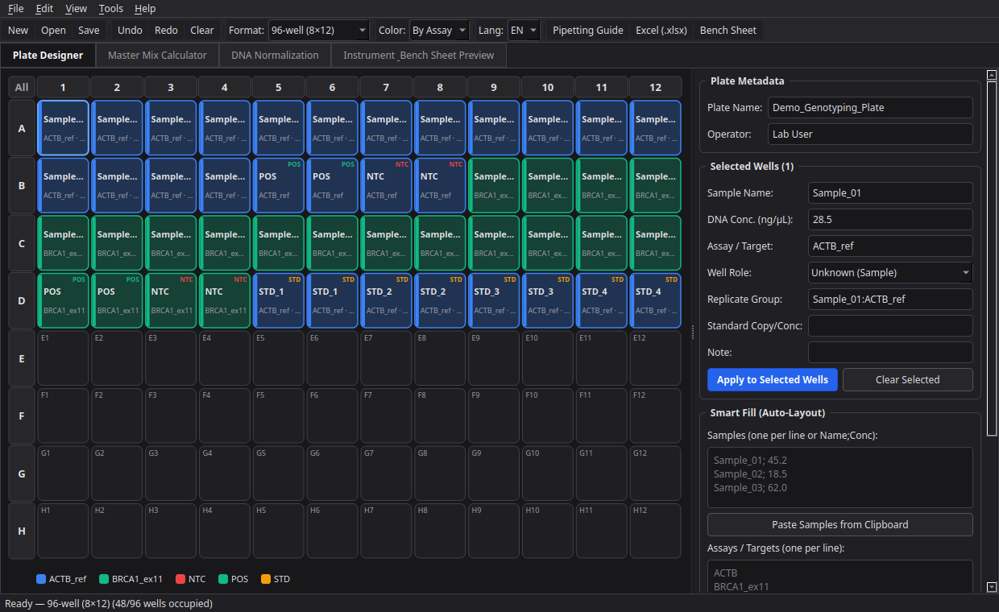
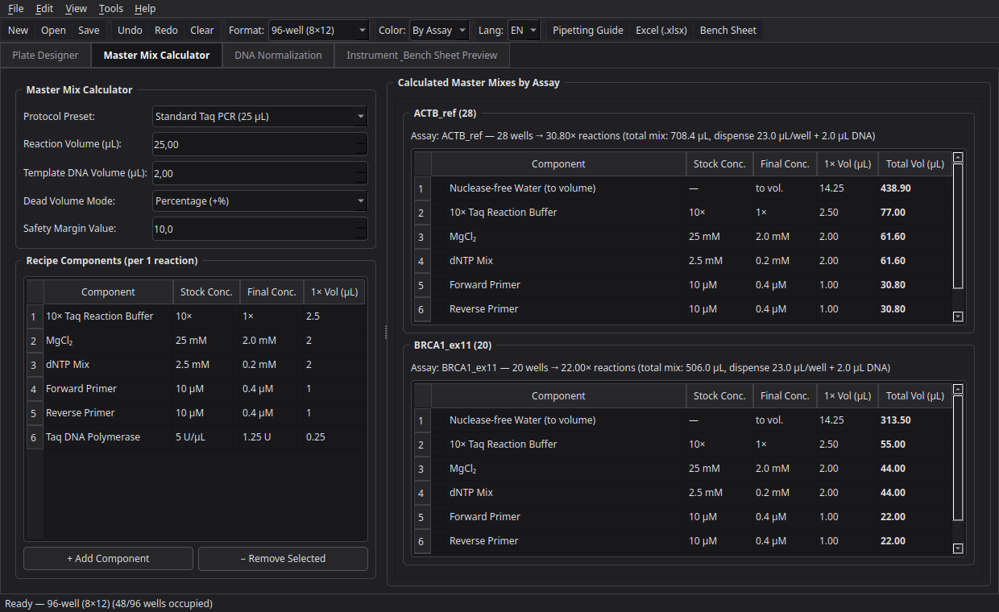
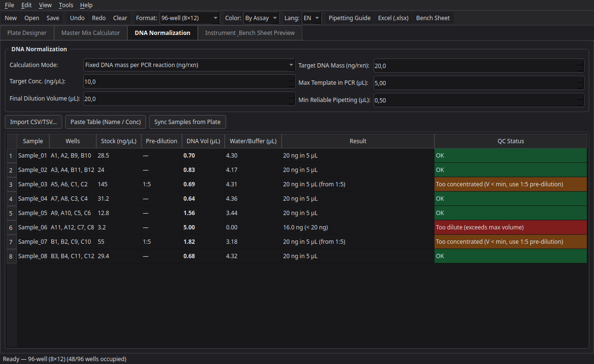
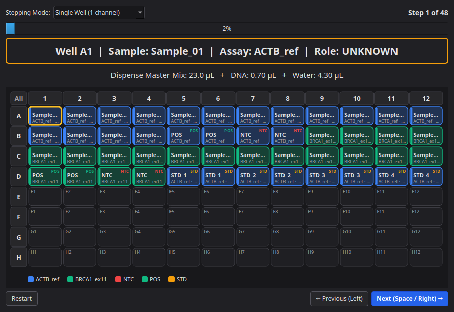
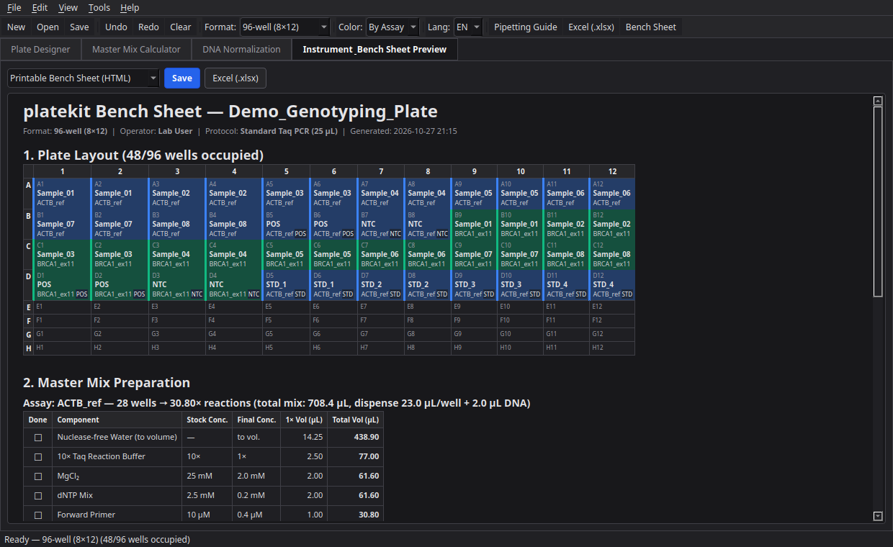

# platekit

English | [Русский](README.ru.md)

Open-source desktop tool for planning 96/384-well PCR, qPCR, PCR-RFLP and Sanger sequencing plates, calculating Master Mixes with dead-volume margins, normalizing DNA concentrations (`C₁V₁ = C₂V₂`) and exporting directly to real laboratory instruments. English/Russian interface, dark and light themes.



## Features

### 1. Interactive Plate Designer
- **Supported formats:** 96-well (`8×12`), 384-well (`16×24`), 8-well and 12-well PCR strips, Qiagen Rotor-Gene rotors (`36`, `72`, `100` positions).
- **Rich well metadata:** Sample name, stock DNA concentration (`ng/µL`), Assay / Target name, Well Role (`Unknown`, `NTC`, `POS`, `STD`, `IPC`, `Empty`), Replicate Group, Standard copy number/quantity, and custom notes.
- **Smart Fill (Auto-Layout):** Paste a list of samples (with optional NanoDrop/Qubit concentrations) and assays to populate replicates (`×1..×12`) row-wise or column-wise with automatic `POS` and `NTC` controls per assay.
- **Serial Standards Generator:** Create `STD` calibration dilution series (`1:10`, `1:5`, `1:2`, etc.) in replicates.
- **Full editing workflow:** Rubber-band selection, row/column header selection, copy/paste well blocks (`Ctrl+C` / `Ctrl+V`), unlimited Undo/Redo (`Ctrl+Z` / `Ctrl+Y`).

### 2. Master Mix Calculator
- **Built-in & editable protocol presets:**
  - *Standard Taq PCR (25 µL)*
  - *qPCR SYBR Green 2× Mix (20 µL)*
  - *qPCR TaqMan Probe 2× Mix (20 µL)*
  - *PCR-RFLP Restriction Digest (15 µL)* — pairs with [`rflppicker`](https://github.com/adrobi/rflppicker)
  - *Sanger Sequencing BigDye v3.1 (10 µL)* — pairs with [`ab1kit`](https://github.com/adrobi/ab1kit)
- **Automatic per-assay grouping:** Counts occupied wells for every Assay on the plate and computes exact reagent volumes and nuclease-free water to volume.
- **Dead-volume modes:** Percentage overfill (`+10%`), fixed extra reactions (`+1`, `+2`), or multichannel reservoir mode (`+%` with a minimum of `+2` reactions).



### 3. DNA Normalization & Pipetting QC
- **Two calculation modes:**
  1. **Per-reaction DNA mass (`ng/rxn`):** Computes exact DNA template volume and water volume for each well.
  2. **Dilution plate normalization (`C₁V₁ = C₂V₂`):** Computes volumes to normalize stocks to a uniform target concentration (`ng/µL`) in a target final volume.
- **Automated Pipetting QC flags:**
  - `OK` — directly pipettable volume.
  - `TOO_CONCENTRATED` — required volume is below minimum reliable pipetting threshold (e.g. `< 0.5 µL`); automatically suggests a clean pre-dilution factor (`1:5`, `1:10`, `1:20`, `1:50`).
  - `TOO_DILUTE` — stock concentration is too low to reach the target mass within the maximum template volume window.



### 4. Step-by-Step Pipetting Assistant & Printable Bench Sheet
- **Interactive Bench Mode:** Step through occupied wells one by one (single-channel), column by column (8-channel pipette), or row by row (12-channel pipette) using `Space` / `Arrow` keys while highlighting the active well/strip on the plate map.
- **Printable A4 Bench Sheet (`.html`):** Self-contained 1-page laboratory protocol with color-coded plate map, checkable `[ ]` Master Mix recipes, and DNA normalization table.



### 5. Instrument & Ecosystem Export / Import
- **Bio-Rad CFX Maestro / CFX Manager** (`.csv` Plate Setup)
- **Applied Biosystems QuantStudio / StepOne** (`.csv` Sample Setup)
- **Qiagen Rotor-Gene Q** (`.csv` rotor layout)
- **ABI 3130 / 3500 Capillary Sequencer** (`.tsv` Sample Sheet with systematic `.ab1` file naming for [`ab1kit`](https://github.com/adrobi/ab1kit))
- **Multi-sheet Excel Workbook (`.xlsx`):** Colored `Plate Map`, `Master Mix`, `DNA Normalization`, and `Well List` sheets.



---

## Installation & Quick Start

Requires **Python 3.11+**.

```bash
python3 -m venv .venv
source .venv/bin/activate   # Windows: .venv\Scripts\activate
pip install -e ".[dev]"
```

Launch the desktop GUI:

```bash
platekit
# or
python plate_cli.py
```

Headless CLI export example:

```bash
platekit --demo \
  --save-project examples/demo_plate.platekit.json \
  --export-xlsx plate_report.xlsx \
  --export-bench bench_sheet.html \
  --export-cfx biorad_cfx.csv
```

Run tests:

```bash
pytest
```

## License

MIT License — Copyright (c) 2026 Aleksey Drobin ([@adrobi](https://github.com/adrobi)).
