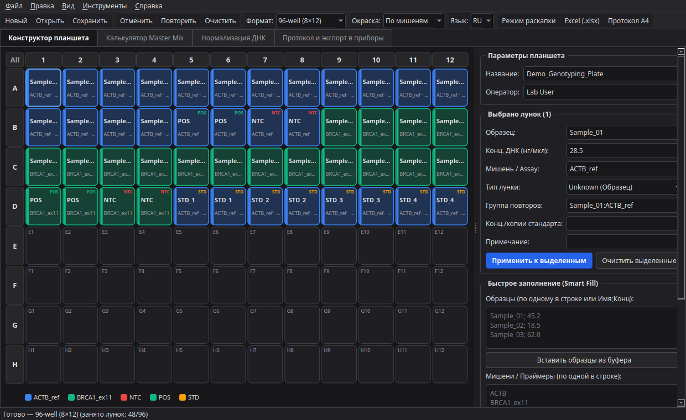
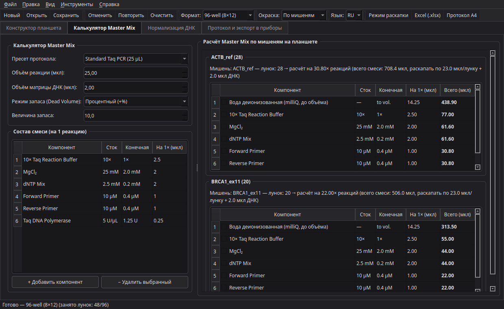
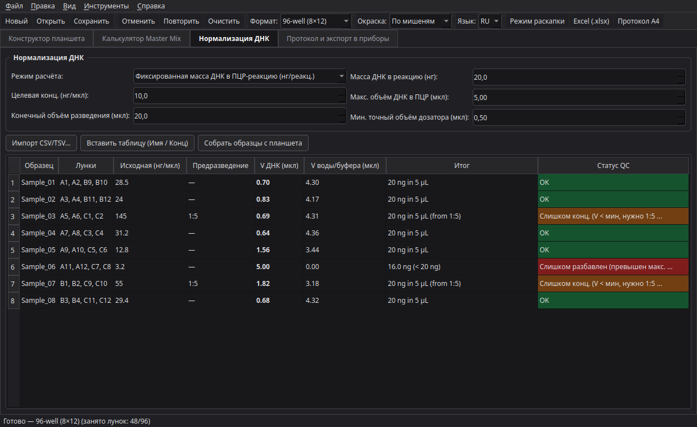
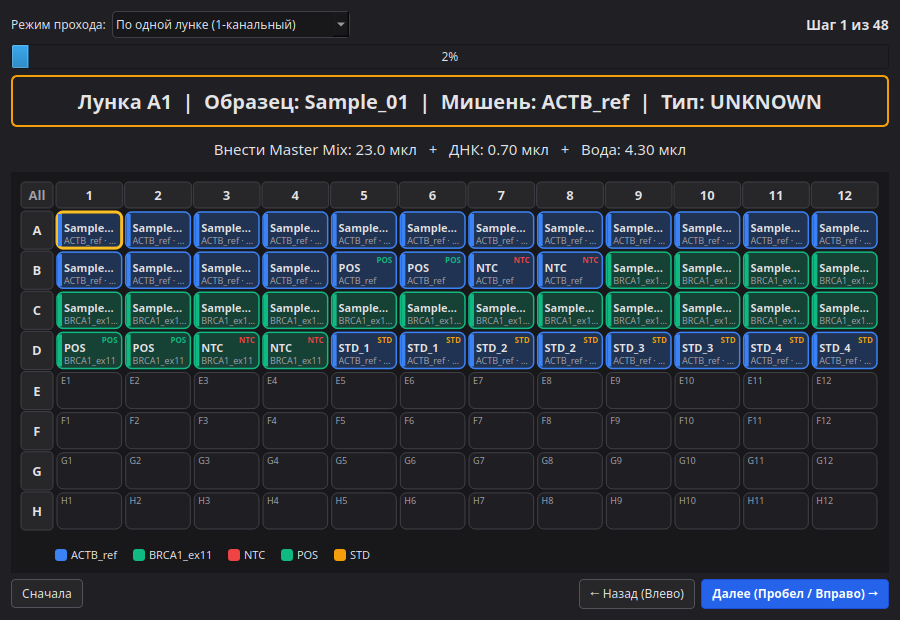
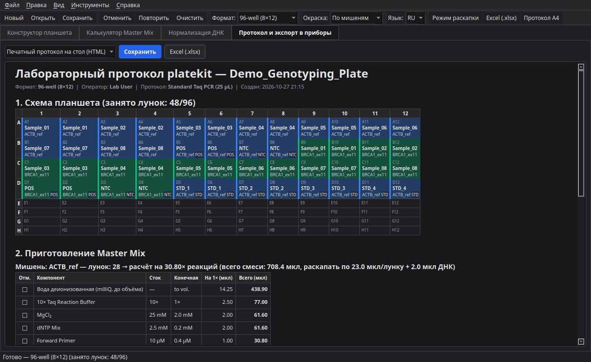

# platekit

[English](README.md) | Русский

Открытое десктопное приложение для планирования 96/384-луночных планшетов (ПЦР, qPCR, ПЦР-ПДРФ и капиллярное секвенирование по Сэнгеру), расчёта Master Mix с запасом на пипетирование, нормализации концентраций ДНК (`C₁V₁ = C₂V₂`) и экспорта раскладок напрямую в реальные лабораторные приборы. Русский и английский интерфейс, тёмная и светлая темы.



## Возможности

### 1. Интерактивный конструктор планшетов
- **Поддерживаемые форматы:** 96 лунок (`8×12`), 384 лунки (`16×24`), ПЦР-стрипы на 8 и 12 лунок, роторы Qiagen Rotor-Gene (`36`, `72`, `100` позиций).
- **Полная информация по каждой лунке:** имя образца, исходная концентрация ДНК (`нг/мкл`), мишень / праймерная система (`Assay`), тип лунки (`Unknown`, `NTC`, `POS`, `STD`, `IPC`, `Empty`), группа повторов, количество копий стандарта и примечание.
- **Быстрое заполнение (Smart Fill):** вставка списка образцов (вместе с концентрациями из NanoDrop / Qubit) и списка мишеней с автоматической раскладкой в повторах (`×1..×12`) по строкам или столбцам и добавлением контролей `POS` / `NTC`.
- **Генератор серийных разведений (`STD`):** автоматическое создание калибровочной шкалы стандартов (`1:10`, `1:5`, `1:2` и т.д.).
- **Удобное редактирование:** выделение рамкой (rubber-band), выбор целых строк и столбцов кликом по заголовку, копирование/вставка блоков лунок (`Ctrl+C` / `Ctrl+V`), неограниченный `Undo / Redo` (`Ctrl+Z` / `Ctrl+Y`).

### 2. Калькулятор Master Mix
- **Встроенные и редактируемые пресеты протоколов:**
  - *Standard Taq PCR (25 мкл)*
  - *qPCR SYBR Green 2× Mix (20 мкл)*
  - *qPCR TaqMan Probe 2× Mix (20 мкл)*
  - *PCR-RFLP Restriction Digest (15 мкл)* — прямая связка с [`rflppicker`](https://github.com/adrobi/rflppicker)
  - *Sanger Sequencing BigDye v3.1 (10 мкл)* — прямая связка с [`ab1kit`](https://github.com/adrobi/ab1kit)
- **Автоподсчёт по мишеням:** программа сама считает число занятых лунок для каждой мишени (`Assay`) и рассчитывает объёмы реагентов и воды.
- **Три режима запаса (Dead Volume):** процентный (`+10%`), фиксированное число дополнительных реакций (`+1`, `+2`) или режим многоканального дозатора (`+%`, но не менее `+2` реакций).



### 3. Нормализация ДНК и контроль точности пипетирования
- **Два режима расчёта:**
  1. **Фиксированная масса ДНК в реакцию (`нг/реакц.`):** считает, сколько мкл ДНК и сколько мкл воды вносить в каждую лунку.
  2. **Нормализация в планшете разведений (`C₁V₁ = C₂V₂`):** приводит все образцы к единой концентрации (`нг/мкл`) в заданном конечном объёме.
- **Автоматические флаги контроля качества (Pipetting QC):**
  - `OK` — объём комфортно дозируется напрямую.
  - `TOO_CONCENTRATED` — расчётный объём ДНК меньше минимального точного объёма пипетирования (`< 0.5 мкл`); программа автоматически предлагает удобное предварительное разведение (`1:5`, `1:10`, `1:20`, `1:50`).
  - `TOO_DILUTE` — исходная концентрация слишком низкая и не укладывается в максимальный объём матрицы.



### 4. Пошаговый помощник раскапки и печатный протокол А4
- **Интерактивный режим «У стола»:** пошаговая подсветка текущей лунки (для 1-канального дозатора), целого столбца (для 8-канального дозатора) или строки (для 12-канального дозатора) с переключением клавишами `Пробел` / `Стрелки`.
- **Печатный лист Bench Sheet (`.html`):** готовый к печати на 1 лист А4 лабораторный протокол с цветной схемой планшета, рецептами Master Mix с чекбоксами `[ ]` и таблицей разведений ДНК.



### 5. Экспорт и импорт для реальных приборов
- **Bio-Rad CFX Maestro / CFX Manager** (`.csv` Plate Setup)
- **Applied Biosystems QuantStudio / StepOne** (`.csv` Sample Setup)
- **Qiagen Rotor-Gene Q** (`.csv` список позиций ротора)
- **Секвенатор ABI 3130 / 3500** (`.tsv` Sample Sheet с систематическими именами `.ab1` файлов для последующего открытия в [`ab1kit`](https://github.com/adrobi/ab1kit))
- **Многолистовая книга Excel (`.xlsx`):** листы `Plate Map` (с цветовой заливкой лунок), `Master Mix`, `DNA Normalization` и `Well List`.



---

## Установка и запуск

Требуется **Python 3.11+**.

```bash
python3 -m venv .venv
source .venv/bin/activate   # Windows: .venv\Scripts\activate
pip install -e ".[dev]"
```

Запуск графического интерфейса:

```bash
platekit
# или
python plate_cli.py
```

Пакетный экспорт из командной строки:

```bash
platekit --demo \
  --save-project examples/demo_plate.platekit.json \
  --export-xlsx plate_report.xlsx \
  --export-bench bench_sheet.html \
  --export-cfx biorad_cfx.csv
```

Запуск тестов:

```bash
pytest
```

## Лицензия

MIT License — Copyright (c) 2026 Алексей Дробин ([@adrobi](https://github.com/adrobi)).
